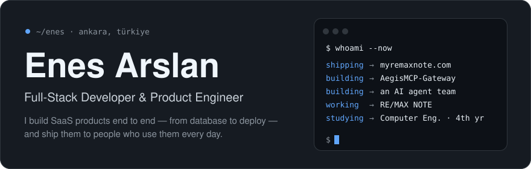
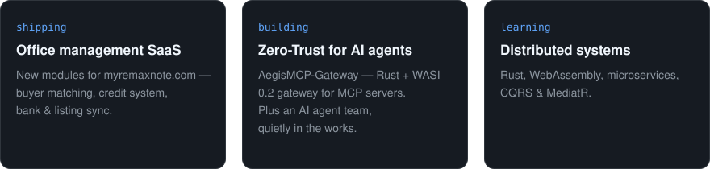
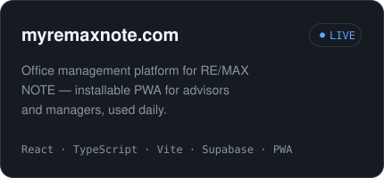
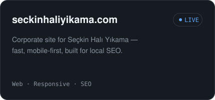

<div align="center">



<br/>

[](https://myremaxnote.com)
[](https://seckinhaliyikama.com)
[](mailto:metinesa@gmail.com)
[](https://www.linkedin.com/in/enes57)


</div>

<br/>

## `01` — Right now



## `02` — About

Computer Engineering student who ships production software on the side. I work solo across the stack at **RE/MAX NOTE** in Ankara — internal tools, websites and a full management platform — with AI-augmented development as my daily workflow.

```text
role     Software Developer · RE/MAX NOTE
before   Intern · RE/MAX Türkiye HQ
school   Tokat Gaziosmanpaşa University — Computer Engineering
ask me   React · PWA · .NET · SQL · Supabase · Unity
```

## `03` — In production

<a href="https://myremaxnote.com"></a>
<a href="https://seckinhaliyikama.com"></a>

## `04` — Open source

<table>
<tr>
<td width="50%" valign="top">

**[AegisMCP-Gateway](https://github.com/EnesSamaa/AegisMCP-Gateway)**<br/>
Zero-Trust gateway & reverse proxy for MCP — WASI sandboxing, per-tool authorization, Merkle-proof audit logs.<br/>
`Rust` `WASI` `MCP`

</td>
<td width="50%" valign="top">

**[mcp-safegate](https://github.com/EnesSamaa/mcp-safegate)**<br/>
Security proxy that gatekeeps every call between AI agents and MCP servers.<br/>
`Rust` `WASI` `Merkle Trees`

</td>
</tr>
<tr>
<td width="50%" valign="top">

**[friendzone-backend](https://github.com/EnesSamaa/friendzone-backend)**<br/>
Location-based social matching API — matching, invites and AI-generated profiles.<br/>
`C#` `.NET` `SQL`

</td>
<td width="50%" valign="top">

**[ZORBALIK-KALKANI](https://github.com/EnesSamaa/ZORBALIK-KALKANI)**<br/>
Real-time cyberbullying detection that flags online harassment with NLP.<br/>
`Python` `NLP` `AI`

</td>
</tr>
</table>

<sub>also → [Otomasyon](https://github.com/EnesSamaa/Otomasyon) (Selenium booking automation) · [MobileGameStartMenu](https://github.com/EnesSamaa/MobileGameStartMenu) (Unity menu + shaders) · [Prensesi-Kurtarma](https://github.com/EnesSamaa/Prensesi-Kurtarma) (2D Unity platformer)</sub>

## `05` — Stack

<div align="center">

| | |
| :-- | :-- |
| **Frontend** |     |
| **Backend** |     |
| **Data** |     |
| **Systems & more** |     |

</div>

## `06` — Activity

<div align="center">


<br/><br/>


</div>

<br/>

<div align="center">

*"Ship it, learn from it, ship it better."*


</div>
